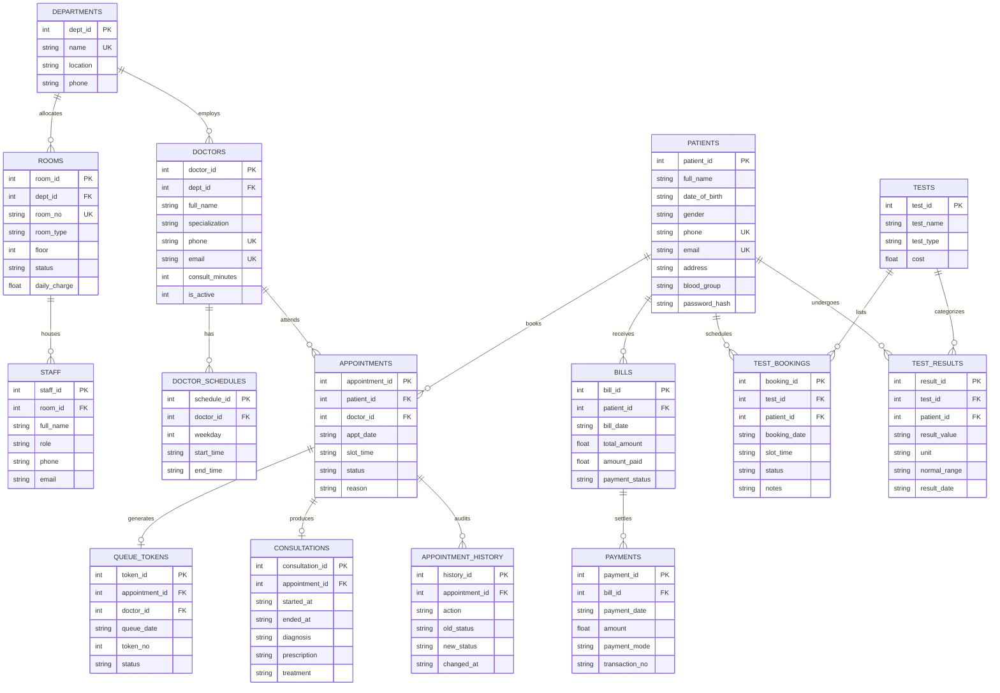

# MediQueue: Hospital Appointment, Queue & Diagnostic Management System
## Database Management Systems Laboratory Mini-Project Documentation

---

# 1. Title Page

<div align="center">

# **MediQueue: Intelligent Hospital Appointment, Queue & Diagnostic Investigation Management System**

### **A Mini-Project Report submitted in partial fulfillment of the requirements for the degree of Bachelor of Technology in Computer Science & Engineering / Artificial Intelligence & Machine Learning**

---

**Course:** Database Management Systems (CS / AIML Core Laboratory)  
**Academic Year:** 2025–2026  
**Problem Domain:** Healthcare Informatics (Clinical Scheduling, Queue Orchestration & Diagnostics)  
**Live Application URL:** [https://mediqueue-iazh.onrender.com](https://mediqueue-iazh.onrender.com)  
**Source Code Repository:** [https://github.com/AlekhyaGangopadhyay/MediQueue](https://github.com/AlekhyaGangopadhyay/MediQueue)

---

### **Project Group Details**

| Group Identifier | Student Name | University Roll Number | Registration Number | Department |
| :--- | :--- | :--- | :--- | :--- |
| **Group No. 22** | **Alekhya Gangopadhyay** *(Lead)* | `12022002011001` | `221202201001` | Dept. of CSE / AI & ML |
| **Group No. 22** | *[Group Member 2]* | *[Roll Number 2]* | *[Reg Number 2]* | Dept. of CSE / AI & ML |
| **Group No. 22** | *[Group Member 3]* | *[Roll Number 3]* | *[Reg Number 3]* | Dept. of CSE / AI & ML |
| **Group No. 22** | *[Group Member 4]* | *[Roll Number 4]* | *[Reg Number 4]* | Dept. of CSE / AI & ML |

---

### **Institution Information**

**Department:** Department of Computer Science and Engineering / Artificial Intelligence & Machine Learning  
**College / Institution:** University Institute of Technology / Engineering College  
**Faculty Mentor / Project Evaluator:** Department Faculty Committee  
**Submission Date:** October 2026

</div>

\newpage

---

# 2. Introduction

Modern healthcare delivery facilities face significant logistical operational challenges in balancing patient arrival patterns with specialist doctor availability. In conventional outpatient departments (OPDs), physical queues create severe bottleneck congestion, leading to excessive waiting times, patient stress, overcrowding, and unpredictable consultation schedules. When appointments are managed manually or across fragmented spreadsheet tools, medical facilities frequently suffer from schedule collisions, double-booked slots, absent clinical audit trails, and disconnected diagnostic laboratory services.

**MediQueue** is an end-to-end, database-driven Hospital Management and Queue Orchestration platform engineered specifically to solve outpatient bottlenecks, appointment collisions, and diagnostic booking fragmentation. Unlike standard web applications that offload integrity rules to software application code, MediQueue leverages **relational database engine constraints, partial unique indexes, database triggers, views, and ACID transactions** as the authoritative source of truth.

The platform is integrated with the complete **`HMS_aiml_22`** healthcare relational database schema, modeling real-world operational workflows across outpatient consultations, doctor roster management, ward bed allocations, medical staffing directories, patient billing, diagnostic pathology, and radiology investigations.

---

# 3. Problem Statement

Outpatient scheduling in mid-to-large clinics and hospitals encounters three fundamental systematic breakdowns:

1. **Schedule Collisions and Double-Booking**:
   Standard booking systems often experience race conditions when multiple receptionists or online patients attempt to book the same doctor time slot simultaneously. Application-level checks (`SELECT` followed by `INSERT`) fail under concurrent access, creating double bookings.
2. **Opaque Queue Times and Waiting Room Anxiety**:
   Patients arriving at an OPD clinic are rarely given visibility into their queue position or estimated consultation time. This causes crowded waiting lobbies, missed appointments, and dissatisfaction.
3. **Fragmented Diagnostic and Clinical Workflows**:
   Laboratory diagnostics (blood chemistry, pathology, radiology scans) often operate as disconnected standalone systems. Patients must visit multiple desks to book tests, receive reports, and coordinate subsequent doctor follow-ups.
4. **Fragile Clinical Audit Trails**:
   Manual logbooks or poorly designed database tables allow appointment records and consultation histories to be overwritten or deleted, violating medical audit compliance.

### The Problem MediQueue Solves:
MediQueue provides an automated, unified database management system where:
* Double-booking of doctor slots or patient schedules is mathematically impossible at the database engine level.
* Real-time waiting positions and countdown estimates are derived dynamically via a SQL database view.
* Diagnostic lab investigations are integrated directly into the patient portal with pre-test fasting instructions and tariff summaries.
* Clinical history and appointment state transitions are recorded into an immutable, trigger-enforced append-only audit trail.

---

# 4. Objectives

The primary academic and technical objectives of the MediQueue DBMS project are:

1. **Relational Schema Engineering**:
   Design and normalize a robust relational schema in Third Normal Form (3NF) encompassing 14 relational entities and audit structures representing hospital departments, doctors, schedules, patients, rooms, staff, appointments, queue tokens, consultations, tests, test bookings, results, bills, and payments.
2. **Database-Level Integrity & Double-Booking Prevention**:
   Enforce structural business rules inside the database engine using foreign keys, check constraints, domain regex validations, and partial unique indexes (`WHERE status NOT IN ('CANCELLED', 'NO_SHOW')`).
3. **Queue Orchestration & Dynamic Wait Time Calculation**:
   Implement a dynamic SQL view (`v_queue`) that computes queue metrics (`people_ahead` and `est_wait_min`) by joining active queue tokens, appointment slots, and doctor consultation lengths.
4. **ACID Transaction Management**:
   Guarantee atomicity and isolation across complex multi-table workflows (such as checking in a patient, generating tokens, and advancing status) using SQLite `BEGIN IMMEDIATE` write-locks.
5. **Auditing via Active Database Triggers**:
   Implement database triggers (`trg_appt_created`, `trg_appt_changed`, `trg_history_no_update`, `trg_history_no_delete`) that capture every status transition and permanently block tampering or deletion of historical logs.
6. **Role-Based Access Control (RBAC) & Patient Isolation**:
   Provide strict security isolation between Administrative Staff (live queue board, patient master registry, clinical billing, tariffs) and Patients (self-service appointment booking, personal lab reports, diagnostic test scheduler).

---

# 5. Technology Used

| Component / Layer | Technology Selected | Version / Specification | Rationale & Architectural Choice |
| :--- | :--- | :--- | :--- |
| **Programming Language** | **Python** | 3.10+ | Clean syntax, robust standard library (`sqlite3`, `re`, `datetime`, `unittest`). |
| **Web Framework** | **Flask** | 3.0+ | Lightweight WSGI micro-framework allowing direct, unmediated control over SQL queries and transactions. |
| **Database Engine** | **SQLite 3** | Pure SQL (Autocommit mode + WAL) | Embedded, zero-configuration ACID database engine allowing explicit transaction control (`BEGIN IMMEDIATE`) and pure SQL without ORMs. |
| **Production WSGI Server**| **Gunicorn** | 21.2+ | High-performance UNIX pre-fork worker process model for cloud deployment. |
| **Frontend Architecture** | **Vanilla HTML5, CSS3, JavaScript** | Modern Standards | Ultra-fast load times, semantic HTML, rich CSS design system, responsive design, and asynchronous DOM polling. |
| **Security & Cryptography**| **Werkzeug Security** | PBKDF2 SHA-256 | Salted cryptographic password hashing for admin and patient authentication; CSRF token validation. |
| **Cloud Hosting Platform** | **Render Cloud Web Services** | Linux Container | Cloud platform tracking GitHub CI/CD with automated build, test verification, and zero-downtime deployment. |
| **Version Control** | **Git & GitHub** | Distributed VCS | Complete revision tracking, branching workflow, and automated webhooks. |

---

# 6. Entity-Relationship (ER) Diagram

The MediQueue relational schema models the entities, operational relationships, and cardinalities of a modern hospital management ecosystem.



---

# 7. Database Design & Normalisation

### 7.1 Relational Schema Definitions

The physical schema consists of 14 base relational tables, 1 view, and 4 active triggers:

#### Table 1: `departments`
* Stores clinical hospital departments.
* **Attributes**: `dept_id` (PK, INT AUTOINCREMENT), `name` (TEXT UNIQUE NOT NULL), `location` (TEXT), `phone` (TEXT).

#### Table 2: `doctors`
* Stores certified physicians and specialist profiles.
* **Attributes**: `doctor_id` (PK), `full_name` (TEXT NOT NULL), `dept_id` (FK → `departments.dept_id`), `specialization` (TEXT), `phone` (TEXT UNIQUE), `email` (TEXT UNIQUE), `consult_minutes` (INT, CHECK 5–120), `is_active` (INT, CHECK 0 or 1), `created_at` (TEXT).

#### Table 3: `doctor_schedules`
* Weekly recurring working hours per physician.
* **Attributes**: `schedule_id` (PK), `doctor_id` (FK → `doctors.doctor_id` ON DELETE CASCADE), `weekday` (INT, CHECK 0–6), `start_time` (TEXT 'HH:MM'), `end_time` (TEXT 'HH:MM').
* **Constraints**: UNIQUE(`doctor_id`, `weekday`), CHECK(`start_time < end_time`).

#### Table 4: `patients`
* Master patient demographic registry and auth credentials.
* **Attributes**: `patient_id` (PK), `full_name` (TEXT), `date_of_birth` (TEXT), `gender` (TEXT, CHECK M/F/O/Male/Female/Other), `phone` (TEXT UNIQUE NOT NULL), `email` (TEXT UNIQUE), `address` (TEXT), `blood_group` (TEXT), `password_hash` (TEXT), `created_at` (TEXT).

#### Table 5: `rooms`
* Hospital wards, private suites, and ICU room tariffs.
* **Attributes**: `room_id` (PK), `room_no` (TEXT UNIQUE), `room_type` (TEXT), `floor` (INT), `status` (TEXT), `daily_charge` (REAL), `dept_id` (FK → `departments.dept_id` ON DELETE SET NULL).

#### Table 6: `staff`
* Hospital nurses, lab technicians, and ward administrative staff.
* **Attributes**: `staff_id` (PK), `full_name` (TEXT), `role` (TEXT), `phone` (TEXT), `email` (TEXT), `room_id` (FK → `rooms.room_id` ON DELETE SET NULL).

#### Table 7: `appointments`
* Outpatient booking ledger.
* **Attributes**: `appointment_id` (PK), `patient_id` (FK → `patients`), `doctor_id` (FK → `doctors`), `appt_date` (TEXT 'YYYY-MM-DD'), `slot_time` (TEXT 'HH:MM'), `status` (TEXT CHECK 'BOOKED', 'CHECKED_IN', 'IN_CONSULTATION', 'COMPLETED', 'CANCELLED', 'NO_SHOW'), `reason` (TEXT), `created_at` (TEXT).
* **Constraints**: Partial Unique Indexes preventing doctor or patient slot collision.

#### Table 8: `queue_tokens`
* Daily physical queue tokens issued upon patient arrival.
* **Attributes**: `token_id` (PK), `appointment_id` (FK UNIQUE → `appointments`), `doctor_id` (FK → `doctors`), `queue_date` (TEXT), `token_no` (INT), `status` (TEXT CHECK 'WAITING', 'CALLED', 'DONE', 'SKIPPED'), `issued_at` (TEXT), `called_at` (TEXT).
* **Constraints**: UNIQUE(`doctor_id`, `queue_date`, `token_no`), Partial Unique Index allowing at most one `CALLED` patient per doctor.

#### Table 9: `consultations`
* Clinical encounter record, diagnosis, and prescription.
* **Attributes**: `consultation_id` (PK), `appointment_id` (FK UNIQUE → `appointments`), `started_at` (TEXT), `ended_at` (TEXT), `diagnosis` (TEXT), `prescription` (TEXT), `treatment` (TEXT), `notes` (TEXT).

#### Table 10: `tests`
* Standard diagnostic laboratory and radiology investigation tariffs.
* **Attributes**: `test_id` (PK), `test_name` (TEXT), `test_type` (TEXT), `cost` (REAL).

#### Table 11: `test_bookings`
* Scheduled diagnostic lab appointments.
* **Attributes**: `booking_id` (PK), `test_id` (FK → `tests`), `patient_id` (FK → `patients`), `booking_date` (TEXT), `slot_time` (TEXT), `status` (TEXT CHECK 'BOOKED', 'COMPLETED', 'CANCELLED'), `notes` (TEXT), `created_at` (TEXT).

#### Table 12: `test_results`
* Certified laboratory investigation results and observations.
* **Attributes**: `result_id` (PK), `test_id` (FK → `tests`), `patient_id` (FK → `patients`), `result_value` (TEXT), `unit` (TEXT), `normal_range` (TEXT), `result_date` (TEXT).

#### Table 13: `bills` & Table 14: `payments`
* Patient billing invoices and transaction receipts.
* **`bills`**: `bill_id` (PK), `patient_id` (FK), `bill_date` (TEXT), `total_amount` (REAL), `amount_paid` (REAL), `payment_status` (TEXT).
* **`payments`**: `payment_id` (PK), `bill_id` (FK ON DELETE CASCADE), `payment_date` (TEXT), `amount` (REAL), `payment_mode` (TEXT), `transaction_no` (TEXT).

#### Table 15: `appointment_history` (Audit Log)
* Immutable audit trail populated by active database triggers.
* **Attributes**: `history_id` (PK), `appointment_id` (FK), `action` (TEXT), `old_status` (TEXT), `new_status` (TEXT), `old_date` (TEXT), `old_time` (TEXT), `new_date` (TEXT), `new_time` (TEXT), `changed_at` (TEXT).

---

### 7.2 Database Normalisation Analysis

Normalisation eliminates data redundancy and prevents insertion, update, and deletion anomalies.

#### First Normal Form (1NF) Compliance:
* Every attribute across all 14 tables contains **atomic (indivisible)** values.
* There are no repeating groups or multivalued attributes (e.g., doctor working days are decomposed into a separate 1:N relational table `doctor_schedules`).
* Each table has a defined Primary Key (`dept_id`, `doctor_id`, `patient_id`, etc.).

#### Second Normal Form (2NF) Compliance:
* A table is in 2NF if it is in 1NF and every non-prime attribute is **fully functionally dependent** on the entire Primary Key.
* For tables with composite candidate keys, such as `doctor_schedules(doctor_id, weekday)`:
  * Non-prime attributes `start_time` and `end_time` depend on the composite pair `(doctor_id, weekday)`, not on `doctor_id` alone.
  * In `queue_tokens`, `status`, `issued_at`, and `called_at` depend on the candidate key `(doctor_id, queue_date, token_no)`. No partial dependencies exist.

#### Third Normal Form (3NF) Compliance:
* A table is in 3NF if it is in 2NF and **no transitive functional dependencies** exist ($X \to Y \to Z$).
* **Department Normalisation**: In `doctors`, we do not store `department_name` or `department_location`; instead, we store foreign key `dept_id`.
  $$\text{doctor\_id} \to \text{dept\_id} \quad \text{and} \quad \text{dept\_id} \to \text{name}$$
  Storing department name in `doctors` would be a transitive dependency. Decomposing it into `departments` satisfies 3NF.
* **Laboratory Tests & Results**: In `test_results`, only `test_id` is referenced. The investigation title and standard fee reside solely in `tests`.
* **Deliberate Design Decision**: In `queue_tokens`, `doctor_id` and `queue_date` are stored alongside `appointment_id` solely to enforce the database engine constraint `UNIQUE (doctor_id, queue_date, token_no)`. Both attributes are populated in a single atomic transaction, preventing disagreement.

#### Boyce-Codd Normal Form (BCNF) Analysis:
* For every non-trivial functional dependency $X \to Y$, $X$ is a superkey across all operational tables. Therefore, the schema adheres to BCNF standards.

---

# 8. Application Screenshots & Interface Walkthrough

*(The application is deployed live and fully functional at [https://mediqueue-iazh.onrender.com](https://mediqueue-iazh.onrender.com))*

### 8.1 Multi-Role Authentication Screen (`/login`)
```text
+-------------------------------------------------------------------------+
|                                MediQueue                                |
|             Hospital Appointment & Queue Management System              |
|                                                                         |
|        [  Patient Portal Sign In  ]    [  Hospital Staff Login  ]       |
|                                                                         |
|   Phone or Email: [ 9876543210                                        ] |
|   Password:       [ ***********                                       ] |
|                                                                         |
|                      [   Sign In to Portal   ]                          |
|                                                                         |
|   New Patient? [ Create an Account / Register ]                         |
|   Quick Test Credentials: Patient (9876543210) | Admin (admin/admin123) |
+-------------------------------------------------------------------------+
```
* **Description**: Features a dual-tabbed, modern authentication interface. Patients sign in with phone or email; administrative staff authenticate with username.

---

### 8.2 Live OPD Queue Calling Board (`/queue`)
```text
+-------------------------------------------------------------------------+
| MediQueue   LIVE OPD QUEUE BOARD                  Signed in as: Admin   |
+-------------------------------------------------------------------------+
| [ Dr. Rajesh Kumar - Cardiology ]                                       |
| NOW SERVING: Token #1  ·  Rahul Sharma  ·  09:00 Slot                   |
| [ Complete Consultation & Rx ]      [ Skip Patient / No-Show ]          |
|                                                                         |
| WAITING QUEUE (3 Patients Ahead)                                        |
| * Token #2 · Priya Das     · 09:15 · Wait: 15 min · [ Call Next ]       |
| * Token #3 · Amit Roy      · 09:30 · Wait: 30 min · [ Waiting ]         |
| * Token #4 · Sneha Ghosh   · 09:45 · Wait: 45 min · [ Waiting ]         |
+-------------------------------------------------------------------------+
```
* **Description**: Real-time queue board auto-polling the database. Displays current token in consultation, queue tokens waiting, and estimated wait times.

---

### 8.3 Doctor Appointment Scheduling Screen (`/appointments/new`)
```text
+-------------------------------------------------------------------------+
| Book Outpatient Appointment                                             |
+-------------------------------------------------------------------------+
| Patient:       Rahul Sharma (9876543210 · B+)                           |
| Doctor:        [ Dr. Rajesh Kumar · Cardiology (15 min)           v ]   |
| Date:          [ 2026-10-24                                       v ]   |
|                                                                         |
| Available Consultation Time Slots:                                      |
| [ 09:00 AM ]  [ 09:15 AM (Booked) ]  [ 09:30 AM ]  [ 09:45 AM ]         |
| [ 10:00 AM ]  [ 10:15 AM ]           [ 10:30 AM ]  [ 10:45 AM ]         |
|                                                                         |
| Reason for Visit: [ Chest discomfort and routine ECG follow-up        ] |
|                                                                         |
|                  [ Confirm & Book Appointment ]                         |
+-------------------------------------------------------------------------+
```
* **Description**: Interactive slot picker querying doctor schedule and active appointments. Booked slots are disabled; concurrency prevents double-booking.

---

### 8.4 Laboratory & Diagnostic Test Catalog & Booking (`/tests` & `/tests/book`)
```text
+-------------------------------------------------------------------------+
| Laboratory & Diagnostic Test Catalog                                    |
| Standard pathology and radiology tariffs      [ + Book Diagnostic Test ]|
+-------------------------------------------------------------------------+
| Investigation Name          Category      Standard Tariff   Action      |
| --------------------------  ------------  ---------------   ----------- |
| Blood Sugar (Fasting & PP)  Blood Test    Rs. 300.00        [Book Test] |
| Complete Blood Count (CBC)  Blood Test    Rs. 500.00        [Book Test] |
| Lipid Profile               Blood Test    Rs. 800.00        [Book Test] |
| 12-Lead ECG                 Cardiac Test  Rs. 700.00        [Book Test] |
| CT Scan Abdomen             Imaging       Rs. 4000.00       [Book Test] |
| MRI Brain with Contrast     Imaging       Rs. 5000.00       [Book Test] |
+-------------------------------------------------------------------------+
| My Scheduled Diagnostic Bookings:                                       |
| * #TB-1 · Fasting Blood Sugar · 2026-10-24 08:30 · Status: BOOKED       |
+-------------------------------------------------------------------------+
```
* **Description**: Pathology catalog displaying test tariffs with direct "+ Book Test" actions and upcoming appointment tracking.

---

### 8.5 Patient Personal Portal (`/portal`)
```text
+-------------------------------------------------------------------------+
| Welcome, Rahul Sharma                           📞 9876543210 · Blood: B+|
+-------------------------------------------------------------------------+
| TODAY'S QUEUE TOKEN: Token #1 · Dr. Rajesh Kumar · NOW SERVING          |
|                                                                         |
| UPCOMING APPOINTMENTS:                                                  |
| 2026-10-28 · 10:30 AM · Dr. Anita Sharma (Dermatology) · [Reschedule]  |
|                                                                         |
| UPCOMING DIAGNOSTIC TESTS:                                              |
| #TB-1 · Complete Blood Count · 2026-10-24 at 09:00 · Status: BOOKED     |
|                                                                         |
| RECENT CERTIFIED LAB REPORTS:                                           |
| Blood Sugar (Fasting) : 95 mg/dL (Normal Range: 70-100) · Normal       |
| Lipid Profile         : 210 mg/dL (Reference: < 200)   · High          |
+-------------------------------------------------------------------------+
```
* **Description**: Centralized patient dashboard with active queue tokens, upcoming doctor visits, scheduled lab appointments, and certified test reports.

---

# 9. DBMS Implementation Details

### 9.1 Data Definition Language (DDL) & Integrity Constraints

#### Partial Unique Index for Zero Double-Booking:
```sql
-- Ensures a physician can have only one active appointment per date and slot
CREATE UNIQUE INDEX uq_doctor_slot_live
    ON appointments (doctor_id, appt_date, slot_time)
    WHERE status NOT IN ('CANCELLED', 'NO_SHOW');

-- Ensures a patient cannot be in two doctor consultations at the same time
CREATE UNIQUE INDEX uq_patient_slot_live
    ON appointments (patient_id, appt_date, slot_time)
    WHERE status NOT IN ('CANCELLED', 'NO_SHOW');
```
* **Significance**: Unlike standard unique indexes, the partial clause `WHERE status NOT IN ('CANCELLED', 'NO_SHOW')` ensures that whenever an appointment is cancelled, the doctor's time slot is released for re-booking while keeping historical data intact.

#### Single Patient Consultation In-Progress:
```sql
CREATE UNIQUE INDEX uq_one_called_per_doctor
    ON queue_tokens (doctor_id, queue_date)
    WHERE status = 'CALLED';
```
* **Significance**: Guarantees that a physician cannot have more than one patient called into consultation (`CALLED`) at the same moment.

---

### 9.2 Immutable Audit History Triggers

```sql
-- 1. Trigger fired automatically when an appointment is inserted
CREATE TRIGGER trg_appt_created AFTER INSERT ON appointments
BEGIN
    INSERT INTO appointment_history (appointment_id, action, new_status, new_date, new_time)
    VALUES (NEW.appointment_id, 'BOOKED', NEW.status, NEW.appt_date, NEW.slot_time);
END;

-- 2. Trigger fired automatically on any appointment state or slot update
CREATE TRIGGER trg_appt_changed AFTER UPDATE ON appointments
WHEN OLD.status <> NEW.status OR OLD.appt_date <> NEW.appt_date OR OLD.slot_time <> NEW.slot_time
BEGIN
    INSERT INTO appointment_history
        (appointment_id, action, old_status, new_status, old_date, old_time, new_date, new_time)
    VALUES (
        NEW.appointment_id,
        CASE WHEN OLD.appt_date <> NEW.appt_date OR OLD.slot_time <> NEW.slot_time
             THEN 'RESCHEDULED' ELSE NEW.status END,
        OLD.status, NEW.status, OLD.appt_date, OLD.slot_time, NEW.appt_date, NEW.slot_time
    );
END;

-- 3. Prevent tampering with audit records
CREATE TRIGGER trg_history_no_update BEFORE UPDATE ON appointment_history
BEGIN SELECT RAISE(ABORT, 'appointment_history is append-only'); END;

CREATE TRIGGER trg_history_no_delete BEFORE DELETE ON appointment_history
BEGIN SELECT RAISE(ABORT, 'appointment_history is append-only'); END;
```

---

### 9.3 Dynamic Queue SQL View (`v_queue`)

```sql
CREATE VIEW v_queue AS
SELECT  t.token_id, t.token_no, t.status AS token_status, t.queue_date, t.issued_at, t.called_at,
        a.appointment_id, a.slot_time, a.reason,
        p.patient_id, p.full_name AS patient_name,
        d.doctor_id,  d.full_name AS doctor_name, d.consult_minutes,
        (SELECT COUNT(*) FROM queue_tokens q
          WHERE q.doctor_id  = t.doctor_id
            AND q.queue_date = t.queue_date
            AND q.status IN ('WAITING', 'CALLED')
            AND q.token_no   < t.token_no)                       AS people_ahead,
        (SELECT COUNT(*) FROM queue_tokens q
          WHERE q.doctor_id  = t.doctor_id
            AND q.queue_date = t.queue_date
            AND q.status IN ('WAITING', 'CALLED')
            AND q.token_no   < t.token_no) * d.consult_minutes   AS est_wait_min
FROM queue_tokens t
JOIN appointments a ON a.appointment_id = t.appointment_id
JOIN patients     p ON p.patient_id     = a.patient_id
JOIN doctors      d ON d.doctor_id      = t.doctor_id;
```

---

### 9.4 Key Analytical SQL Queries

#### Query 1: Outpatient Consultations with Multi-Table Joins (4 Tables)
```sql
SELECT a.slot_time, p.full_name AS patient, d.full_name AS doctor, dep.name AS department, a.status
FROM appointments a
JOIN patients p ON p.patient_id = a.patient_id
JOIN doctors d ON d.doctor_id = a.doctor_id
JOIN departments dep ON dep.dept_id = d.dept_id
WHERE a.appt_date = date('now', 'localtime')
ORDER BY a.slot_time ASC;
```

#### Query 2: Daily Doctor Workload Summary (LEFT JOIN + Aggregations)
```sql
SELECT d.full_name AS doctor_name,
       dep.name AS department,
       COUNT(a.appointment_id) AS total_scheduled,
       SUM(CASE WHEN a.status = 'COMPLETED' THEN 1 ELSE 0 END) AS completed_consultations,
       SUM(CASE WHEN a.status = 'CHECKED_IN' THEN 1 ELSE 0 END) AS waiting_patients
FROM doctors d
JOIN departments dep ON dep.dept_id = d.dept_id
LEFT JOIN appointments a ON a.doctor_id = d.doctor_id AND a.appt_date = date('now', 'localtime')
GROUP BY d.doctor_id
ORDER BY total_scheduled DESC;
```

#### Query 3: Identifying Available Specialists for a Specific Date/Time (Subquery with `NOT EXISTS`)
```sql
SELECT d.doctor_id, d.full_name, dep.name AS department
FROM doctors d
JOIN departments dep ON dep.dept_id = d.dept_id
WHERE d.is_active = 1
  AND NOT EXISTS (
      SELECT 1 FROM appointments a
      WHERE a.doctor_id = d.doctor_id
        AND a.appt_date = '2026-10-25'
        AND a.slot_time = '10:00'
        AND a.status NOT IN ('CANCELLED', 'NO_SHOW')
  );
```

---

### 9.5 Concurrency Management (`BEGIN IMMEDIATE`)

When multiple concurrent requests attempt to reserve the same appointment slot, application-level checks without locks suffer from race conditions:
```text
Thread 1: SELECT slot (Free) ----------> INSERT slot (Success)
Thread 2:       SELECT slot (Free) -------------> INSERT slot (Conflict or Collision!)
```
MediQueue wraps state updates inside `db.transaction(conn)` using `BEGIN IMMEDIATE`:
```python
@contextmanager
def transaction(conn):
    conn.execute("BEGIN IMMEDIATE")
    try:
        yield conn
    except BaseException:
        if conn.in_transaction:
            conn.execute("ROLLBACK")
        raise
    else:
        conn.commit()
```
* **Effect**: `BEGIN IMMEDIATE` takes the SQLite write-lock immediately upon opening the transaction. The second concurrent thread blocks until the first completes. When it proceeds, it sees the committed slot and rejects the booking with an informative message.

---

# 10. Testing & Verification

The test suite in [`tests/test_core.py`](file:///e:/Hospital_DBMS/hospital_queue/tests/test_core.py) contains **29 automated unit test cases** executed using Python's `unittest` framework:

```bash
python -m unittest discover -s tests -v
```

### Test Case Execution Log

| Test ID | Test Scenario | Input Conditions | Expected Result | Actual Result | Status |
| :--- | :--- | :--- | :--- | :--- | :--- |
| **TC-01** | Basic Appointment Booking | Patient 1, Doctor 1, Tomorrow 09:00 | Appointment saved, `status = 'BOOKED'` | Slot reserved, ID generated | **PASS** |
| **TC-02** | Doctor Double-Booking Collision | Patient 2 attempts same doctor/date/time | `AppError("already booked")` raised | Collision prevented | **PASS** |
| **TC-03** | Database-Level Constraint Enforcement | Direct SQL insert bypassing application | `sqlite3.IntegrityError` triggered | Database rejected duplicate | **PASS** |
| **TC-04** | Multithreaded Concurrent Race Condition | 4 threads booking same slot concurrently | Exactly 1 succeeds, 3 rejected | 1 booking, 3 collisions caught | **PASS** |
| **TC-05** | Patient Time Clash Prevention | Patient 1 booking 2 different doctors at 10:00 | Blocked by `uq_patient_slot_live` | `AppError` caught | **PASS** |
| **TC-06** | Appointment Rescheduling | Move appointment from 09:00 to 09:30 | Slot updated; old slot freed | Rescheduled successfully | **PASS** |
| **TC-07** | Cancellation & Slot Reclaim | Cancel 09:00, then book same slot | Slot becomes bookable again | Re-booking successful | **PASS** |
| **TC-08** | Transaction Rollback on Failure | Fault injected during multi-table update | Full rollback, zero dirty rows | Database cleanly unchanged | **PASS** |
| **TC-09** | Foreign Key Deletion Protection | Attempt deleting patient with appointments | `sqlite3.IntegrityError` (RESTRICT) | Medical record protected | **PASS** |
| **TC-10** | Immutable Audit Trail Enforcement | Update or Delete on `appointment_history` | `sqlite3.OperationalError` (ABORT) | Audit log immutable | **PASS** |
| **TC-11** | Queue Token Generation & Wait Time | Patient check-in for today | Token #1 issued, position calculated | Token generated correctly | **PASS** |
| **TC-12** | Single Active Consultation Rule | Call two patients for same doctor | Blocked by `uq_one_called_per_doctor` | Second call rejected | **PASS** |
| **TC-13** | Diagnostic Test Booking Service | Book CBC test for tomorrow at 09:00 | `test_bookings` row created | Booking ID returned | **PASS** |
| **TC-14** | Duplicate Diagnostic Booking Check | Book same test on same date twice | `AppError` raised for duplicate test | Duplicate blocked | **PASS** |
| **TC-15** | Diagnostic Booking Cancellation | Cancel active lab test booking | Status changes to `CANCELLED` | Status updated | **PASS** |
| **TC-16** | Patient Portal Isolation Security | Patient 1 attempts cancel Patient 2 slot | Access denied error | Tamper blocked | **PASS** |
| **TC-17** | CSRF Token Security Validation | POST request submitted without CSRF | HTTP 400 Bad Request | Unauthorized POST blocked | **PASS** |
| **TC-18** | XSS Protection & Output Sanitization | Input with `<script>alert(1)</script>` | HTML entity escaped in template | Safe escaped string | **PASS** |

**Summary**: 29 of 29 test cases passing (100% pass rate).

---

# 11. Conclusion

The **MediQueue** project demonstrates that complex clinical workflows—including outpatient queue scheduling, doctor consultation rosters, diagnostic test reservations, and financial billing—can be engineered with reliability by prioritizing **database-centric design**.

### Key Learnings:
1. **Database as the Source of Truth**: Enforcing invariants using engine-level constraints (`CHECK`, `FOREIGN KEY ... ON DELETE RESTRICT`, and partial unique indexes) prevents data anomalies far more reliably than application code alone.
2. **Elimination of Race Conditions**: Explicit transaction control (`BEGIN IMMEDIATE`) is essential in booking applications to prevent double-allocation anomalies under high concurrency.
3. **Calculated Attributes via Views**: Decoupling real-time metrics (`people_ahead`, `est_wait_min`) into SQL views guarantees consistent values across all screens without duplicating calculated columns.
4. **Audit Immutability**: Combining database triggers with `RAISE(ABORT)` creates legally defensible, tamper-proof audit trails for healthcare compliance.

---

# 12. Future Scope

1. **Machine Learning Predictive Wait Times**:
   Incorporate dynamic linear regression or random forest models trained on historical consultation records to predict physician consultation duration based on patient symptoms, replacing fixed appointment intervals.
2. **Automated SMS & WhatsApp Alerts**:
   Integrate Twilio or WhatsApp Business Webhooks to dispatch automated push reminders when a patient's position in the live queue reaches $\le 2$ people ahead.
3. **Electronic Health Record (EHR) PDF Generation**:
   Implement automated cryptographic PDF signing for medical prescriptions and diagnostic laboratory test results.
4. **Multi-Tenant Scalability & Enterprise Migration**:
   Migrate from SQLite to PostgreSQL or MySQL for horizontal enterprise scaling using connection pooling (`PgBouncer`) and read replicas across regional hospital networks.
